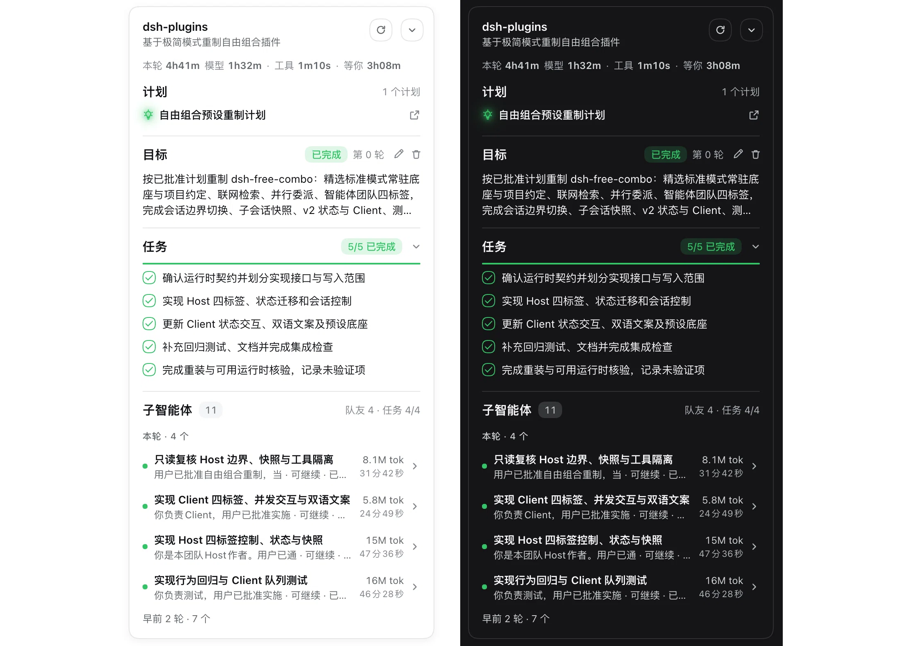
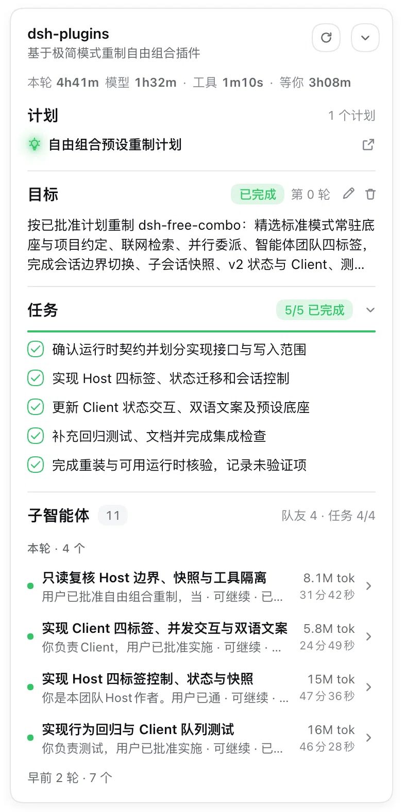
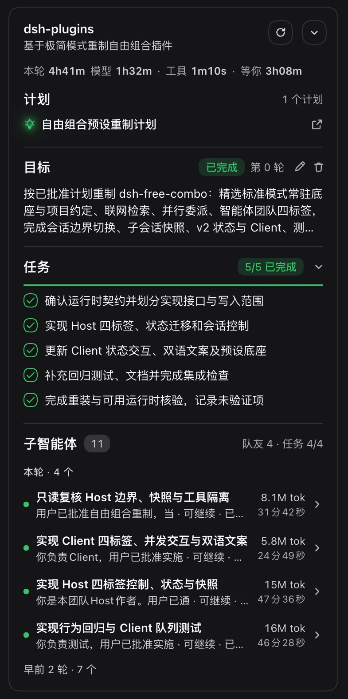

# @liuhusk/dsh-status-card — 内容区右上角状态卡片



[English](README.md) | [简体中文](README.zh-CN.md)

在 DSH Web 的**内容区右上角**浮动一张卡片，汇总**任务**、**目标**、**已提交计划**、**本次变更文件**、
模式状态、**子智能体**与**后台任务**。任务可折叠且带进度条、目标可在卡片里**编辑 / 暂停 / 继续 / 清除**、
计划可点开在右栏预览、子智能体行可点开到对应会话。卡片跟随内容区缩放与右栏开合重定位，可折叠；
**内容区收窄时正文会被卡片推着向左让位，推到极限卡片自动收成一颗圆钮，窗口再变宽又自动展开**；
看全局面板（插件 / 定时任务等）时整卡自动隐藏。
版式按「Codex 式留白 + 统一网格」重做：顶栏项目名 + 会话副标题、裸文字耗时行、分区头带计数 pill、
任务进度条与勾选圆（高亮色可换）、计划行（标题 + 右端外链图标）、子智能体行（两行文本 + 右侧 token/耗时两行）。
**高亮色可换**：卡片里所有高亮部位（勾选环、进度条、进度 pill、状态点、计划灯泡、目标按钮）共用一族颜色，在**插件详情页**里从四档预设里挑（绿 / 蓝 / 琥珀 / 红，默认绿）。
**整张卡片里没有第二块底色**：耗时行只是顶栏下的一行文字，计划行、目标正文、子智能体行也都是裸内容、
与上方内容同宽。
耗时行一行说清这一轮的时间去向：`本轮 25m32s`，后面接细分 `模型 2m44s · 工具 3m04s · 等你 1m12s`——四段同一档字号与颜色，读起来是一句。
起因是 Codex 那类固定位状态卡片——只取"固定位浮动"这一形态作为灵感，**内容按本插件自己的定义**。

## 行为

| 区块 | 内容 | 交互 |
|---|---|---|
| 标题栏 | 项目名（会话 `cwd` 的目录名，悬停显示完整路径）+ 副标题（会话标题，缺省「Agent 工作区」） | 两个**宿主同款圆形按钮**（28px、1px 细描边、白底、里面 16px 图标）：`⟳` 立即重取变更、`⌄` 收起卡片 |
| 高亮色（主题） | 卡片里所有高亮部位共用一族颜色：任务勾选环、2px 进度条、进度 pill、计划灯泡与柔光晕、状态圆点、目标动作按钮与聚焦描边。四档预设：**绿**（默认，= 改动前的观感）、**蓝**（`#4176e6`，= 改动前目标 / 计划的强调色）、**琥珀**、**红**，色值取宿主静态色阶的中调 500（明暗两种模式同值）。宿主静态色阶只有绿 / 蓝 / 靛 / 琥珀 / 红五个色相族，其中 `blue-500`(#3b82f6) 与 `deepseek-500`(#4176e6) 肉眼几乎同色，两档都摆出来等于让用户挑一个看不出差别的颜色，所以「蓝」直接用 deepseek-500、预设只留四档 | 在**插件详情页**（插件 → 本包）的「高亮色」里点色点即换色，卡片当场跟着变；选择存在浏览器本地，刷新后仍是它。「错误 / 警告」色与文件类型图标颜色**不跟主题**（语义色不该被主题带走） |
| 折叠形态 | 折叠后**整张卡片收成一颗圆形按钮**（34px、1px 细描边、白底 + 阴影，跟宿主「回到底部」那颗同款），里面是 `<` 箭头 | 点这颗圆钮即展开卡片；**两种形态之间是伸缩动画**（卡片缩进圆钮 / 从圆钮里长出来，约 220ms，带一点回弹；圆钮就在卡片里那颗收起按钮的位置上，两态**同心重叠**，看起来是同一颗按钮在原地收放），系统开了「减少动态效果」时直接切换；折叠态不占内容区宽度；**宽度不够放卡片时它会自动收成这颗圆钮**（见下条），宽度恢复后再自动展开 |
| 本轮耗时 | 顶栏下的一行裸文字（无底色 / 无圆角 / 无内边距，左边缘与下方各分区的行首对齐）：先给**总计** `本轮 25m32s`（标签「本轮」弱色、数值 600 `--sc-fg`），再接细分 `模型 2m44s · 工具 3m04s · 等你 1m12s`（同样 12px / 600 `--sc-fg` + 等宽数字，段间淡点）——总计只靠位置站队首，**不再单独放大一档字号**。模型 = 本轮 `step/start`→`assistant/message`，工具 = `tool/call`→`tool/result` 配对，**等你 = 人占用的时间**：`ask_user_question` 从发问到用户答完、`exit_plan_mode` 等计划批准、以及工具执行期间弹出的审批（`approval/asked`→`approval/decided`），只算**人真正卡住 agent 的时间**；这一轮交回给用户之后（`turn/end` 以后）数字随轮次**定格**，轮次之间的空闲（看回答 / 想下一步 / 离开）不计 | 只读；**三段互不重叠**（审批那段从工具耗时里扣掉），所以总计 = 三者相加且不会超过这一轮的墙钟；没有等待就不摆「等你」；这一轮没有任何记录则整条不渲染；运行中每 2 秒重取一次、等待中（`waitSince` 存在）每秒重算一次；**与下方各分区内容同宽**（左右不多缩进） |
| 任务 | 官方 `todos` 投影：勾选圆（已完成 = **空心绿环 + 14px 绿勾**、进行中 = 整颗环转圈、其余 = 灰空圈）+ 标题旁绿色进度 pill + 下方 **2px** 进度条 | 分区头右侧 `⌄`/`›` 折叠展开（折叠后进度仍留在分组头）；超过 6 条先折后展（点「查看全部」，硬上限 200） |
| 目标 | 官方 `goal` 投影：阶段（进行中/已暂停/受阻/已完成）、第 n 轮、目标文本、受阻原因 | 卡片内可**编辑**（同条内联 textarea，Enter 保存 / Esc 取消）、**暂停**（active）、**继续**（paused）、**清除**——走官方 `remote.goals` 同一条通道与 CAS 引用 |
| 计划 | Host 路由带回的本会话已提交计划（`exit_plan_mode` 的标题，新的在前，最多 20 条）；行内是裸内容（**不铺底色**，与上方内容同宽；行首一颗自绘的「灯泡 + 周围闪光点」图标（强调色 + 两层 `drop-shadow` 柔光晕，不用实心）、行尾外链图标表示右栏预览；宽度撑满内容、行高紧凑（`4px` 上下内边距 + `1px` 行距）、悬停才浮出胶囊） | 点某行 → 用官方 `plan` 预览类型在右栏打开该计划正文 |
| 本次变更 | 整会话按路径去重的文件清单（每行左侧是**彩色文件类型图标**，按扩展名分类型，**语言也各自分家**：js / ts / json / py / rs / go / java / C 系 / shell / css / 配置（yaml·toml·ini）/ sql / markdown / excel / html / image / pdf / ppt / video / word / 通用 code / other）+ `+added / -deleted` 合计；多轮改动时再按「本轮 · n 个文件」/「更早改动 · n 个文件」两段分组（本轮在前，只有一轮不出分组头） | 点某行 → 打开官方「变更审查」右栏的对应文件 |
| 子智能体 | `parentId` 指向本会话的子会话；行结构与官方「子智能体」目录行一致：状态圆点 + 两行文本（主行 = spawn `label`，副行 = 会话标题 · 模式 · 活动）+ 右侧 **token 用量与耗时各占一行**（靠右、等宽数字）+ 右箭头；分区头 = 「子智能体」+ 计数 pill（= 行数总数，与下方「本轮 · n 个 + 早前 N 轮 · m 个」相加一致）；**行按委派轮次分组**：当前轮次直接摊开，早前的轮次折成一行「早前 N 轮 · m 个」（点开才逐轮列出，组头标「第 n 轮」），只有一轮时不摆任何分组头。`agentTeam` 的队友**不再单独成行**——队友本身就是一条子会话，上面那行已经把它连同 token / 耗时 / 点击入口一起列出来了；只有队友还没有对应会话行时（刚 `provisioning`）才用成员行兜底（主行 teammate 名、副行阶段，无计量与箭头） | 点子智能体行 → 与官方同一通道 `ctx.uiWorkspace.openSession({ parentSessionId, childSessionId, mode })` 切到该子会话；兜底的队友行不可点 |
| 后台任务 | 本会话里 Agent 放到后台跑的作业，结构与宿主自己的「后台任务」面板一致：状态圆点 + `bash` 类型 pill + 等宽命令 + 结算原因（`exit code: 0`）/ 运行中的 `2/10` 进度 + 右端时长（`54秒` / `1分24秒`）。**运行中的常显**（整行铺一层淡底），**已结束的一律折成一行「已结束 N」（默认收起，没有活任务时也收起）**，组头右侧有「清空」 | 每颗运行中的行右端有一颗 **20×20 方形停止按钮**，两段确认（点一下 → 按钮变红框「确认停止」→ 再点才发，3 秒不动自己复位），与宿主面板一致；其余只读。**清空只在本页隐藏已结束行**，不动宿主记录。实时输出仍去宿主面板看 |

- **何时显示**：会话页下**常驻**（只要有主会话就渲染）。有内容时渲染对应区块；全空时 body 显示一行
  「暂无任务与变更」，不整卡消失。耗时条**本身也算内容**——只要这一轮有事件，卡片就可见。
- **面板闸门**：只在会话页渲染。官方 layout 约定 `PanelInfo.activePanelId === null` 表示「中央面板正在
  显示当前会话」，非 `null` 表示用户看的是别的全局面板（`plugins`、`schedules`…）。那种页面上卡片没有
  归属，会直接压住别人的界面，因此整卡不渲染。判据取自座位 standardProps 的 `usePanelInfo`
  （DSH 官方自己也这么判，见 `dsh-client-ui-sidebar-right`），不靠 DOM 猜测；锚点容器同样保留，
  回到会话页立即恢复。宿主没提供这个 hook 时兜底为「当作在看会话」——宁可显示，也不要静默消失。
- **会话区自适应（推让 + 自动收起）**：卡片压不压到正文，取决于**正文列**（居中列）的右缘与卡片左缘。
  宿主把正文列宽度以 `--dsh-chat-content-width` 暴露在内容区元素上，插件读它算几何：
  - 放得下 → 不推让，卡片展开；
  - 快压住正文 → 给内容区元素写 `padding-right`（= 2 × 推让量），居中列被推着**向左自适应**、
    列宽保持不变，卡片与正文之间始终留 `PUSH_TEXT_GAP`（16px）；
  - 推到极限（正文左缘距内容区左缘只剩 `PUSH_MIN_LEFT` = 12px）还压着 → **自动收起**成一颗圆钮，
    同时把推让缩到只给圆钮让位（`PUSH_FAB` = 54px）；
  - 宽度回到放得下（额外要求多让出 `FIT_HYSTERESIS` = 24px 的滞回余量）→ **自动展开**。
  手动点圆钮展开在**当前宽度格局**内有效；宽度一变（`signature = 内容区宽:正文列宽` 变化），
  手动选择立即失效、判定回到自动逻辑——这就是「手动展开后，再触发宽度变化则继续收起」。
  量不到内容区时**不**隐藏（宽度未知一律当作有空间，避免测量失败退化成卡片永久消失）；
  量得到内容区、但宿主没暴露/解析不出正文列宽度时，退回老的 `HIDE_BELOW_CONTENT_WIDTH`（820px）
  保险丝，且**绝不往宿主 DOM 上写 padding**——拿不到真实列宽就不该去推别人的布局。
  `.sc_card` 的宽度（372px）与常量 `CARD_WIDTH` 必须一致，改宽度两处一起改。
  锚点容器（`div.sc_anchor`，`pointer-events:none`、尺寸为 0）**始终保留在 DOM 里**，只有卡片本体
  按闸门增减：它一旦跟着消失，`offsetParent` 就测不到，宽度会读回「未知」→ 卡片又冒出来，来回抖动。
  浮层不参与布局，所以显示/隐藏不会反过来改变内容区宽度，不存在反馈回路。
- **接管官方「任务」面板**：卡片出现的那一代主内容区元素会被加上 `data-status-card-hide-todo`，
  由一条 CSS 隐藏输入框上方那块**纯展示、无操作**的官方任务面板（`[data-testid="todo-panel"]`）。
  官方**目标条保留**（它带暂停/继续/编辑/清除操作）。标记比定位更保守：只有内容区带会话标记
  精确匹配、或页面上只有一代内容区时才标记，多窗格下不会误标别人的面板；
  子代理会话里的同一面板因此不受影响。开关是 `client.js` 顶部的 `HIDE_OFFICIAL_TODO_DOCK`。
  任一闸门收起卡片时（内容区过窄、或不在会话页）会**同步撤掉这个标记**：替代品都不显示了，
  就不该再藏着官方面板，否则用户既看不到卡片、也看不到官方任务视图。
- **折叠态**：模块级记忆，页面会话内有效，刷新页面重置（不落盘）。
- 纯只读：不新增会话事件、不写官方状态、不改任何官方投影。

## 数据来源

| 区块 | 来源 | 说明 |
|---|---|---|
| 会话 / 项目名 / 子代理 | 座位 props 的 `useSessions`（`sessions` 投影） | 主会话 = `retainedBy.mainView > 0` 的那一代 |
| 任务 / 目标 / 队友 | `SessionSummary.projectionValues[key]` | 官方已折叠的投影值，客户端只读；缺失即整块不渲染 |
| 子智能体的委派轮次 | 同一条路由返回的 `subagentTurns: { [childId]: turn }` | Host 扫日志时遇到 `subagent/catalog` 就记下它当时的轮次；客户端据此把「整会话的子会话目录」按轮分组，拿不到归属的行一律算当前轮（不额外造组） |
| 后台任务 | `ctx.jobs`——`@deepseek-ai/dsh-api-job-controller` 的客户端服务，`ctx.inject(['jobs'], …)` 惰性获取：`state`（`getSnapshot()` / `subscribe`）读本会话的行、`watchRows(sessionId)` 管订阅生命周期、`kill(sessionId, jobId)` 接到停止按钮上 | 行就是宿主的 `JobView`（`id / kind / label / status / progress / detail / startedAt / finishedAt / output`）；活行 = `running` / `stopping`；排序照宿主面板（活行按开始时间升序在前，已结束按结束时间降序）；服务缺席时整块不渲染 |
| 变更文件 | 本插件 Host 路由 `GET /api/status-card.changes?sessionId=…`（客户端以文档相对 `api/…` 请求） | 见「实现要点」 |
| 已提交计划 | 同一条路由返回的 `plans: [{ callId, title, seq }]` | plan 模式**不落盘任何文件**，正文只存在于 `exit_plan_mode` 工具参数里；Host 侧从会话日志现扫出索引，客户端才拿得到 `callId` |
| 目标操作 | `ctx.remote.goals.edit / pause / resume / clear`（`ctx.inject(['remote','remote.goals'], …)` 惰性获取） | 与官方目标条同一条 Host Remote；入参为 `{ id, revision }` CAS 引用 |
| 正文列宽度 | 内容区元素上的 CSS 变量 `--dsh-chat-content-width`（宿主布局导出） | 宿主写的是 `clamp(…)`，`getPropertyValue` 只能拿到原样字符串，因此用一个临时探针元素落地成像素（量完即删）；解析失败一律退回 820px 保险丝 |
| 本轮耗时 | 同一条路由返回的 `timing: { turn, modelMs, toolMs, waitMs, waitSince }` | Host 按会话事件自带的 `time`（epoch ms）折叠：模型 = `step/start`→`assistant/message`、工具 = `tool/call`→`tool/result`（按 callId 配对，`ask_user_question` 那段**不算**工具时间）、等你 = 已结算等待区间之和 `waitMs`（提问 / 计划批准 / 审批，区间存成 `[from,to]` 并合并重叠，工具耗时会把落在窗口里的审批时间扣掉），还在等人时由 `waitSince` 带出绝对起点，客户端用渲染时刻算出正在进行的这一段，所以不用重新请求也会长；`turn/end` 之后没有未结算的等待，`waitSince` 变 null、数字定格（轮次之间的空闲不算「等你」） |

## 实现要点

- **座位**：`shell.overlay`（`dsh-client-ui-layout` 声明，kind = list、scope = root）。官方浮层
  `.pI_x6G_overlayLayer` 是 `position:absolute; inset:0; z-index:20; pointer-events:none`，
  slot outlet 自身 `display:contents`，所以不产生多余盒子。卡片用 `position:absolute` + 主内容区
  （`[data-conversation-content]`，优先匹配 `data-conversation-session`）矩形测量定位，
  `anchor.offsetParent` 就是浮层坐标系；`ResizeObserver` 跟随内容区与右栏尺寸变化，
  `window.resize` 兜底；测量成功前使用兜底位置（`top:78 / right:20`），不做跳位动画。
- **内容区可能晚于卡片挂载**：`pickContentElement` 先同步试一次，再用 `MutationObserver` +
  逐帧重试（上限 600 帧）追会话首帧与面板重挂。
- **样式**：只用 `--dsw-*` 主题 token，无任何颜色字面量；`ctx.effect` 注入、卸载回收。
- **统一的高亮色（`--sc-theme`）**：整张卡片只有**一个**色源。`.sc_card` 里 `--sc-theme: var(--dsw-static-green-500)`，
  `--sc-accent: var(--sc-theme)`，弱底色 `--sc-accent-weak: color-mix(in srgb, var(--sc-theme) 16%, transparent)`；
  换主题就是把 `--sc-theme` 换成别的色阶——`data-sc-theme` 落在卡片根上，CSS 用
  `.sc_card[data-sc-theme=x],.sc_themeChip[data-sc-theme=x]` 覆盖（双类选择器 0,2,0 高于 `.sc_card` 的 0,1,0，
  与规则先后无关）。合并之前卡里有 `--sc-ok`（绿）和 `--sc-accent`（蓝紫）两套高亮：任务一路绿、目标与计划一路蓝紫，
  同一张卡两个强调色互相打架；现在勾选环 / 进度条 / pill / 状态点 / 计划灯泡 / 目标按钮 / 聚焦描边全部读同一族。
  **弱底色不再单独配一份浅色档**（旧版是 `--dsw-alias-state-success-tertiary` 这种固定浅色）：用 `color-mix` 现场调，
  否则每加一档主题都得挑一个「浅色下不糊、暗色下不刺眼」的浅色。文件类型图标与错误 / 警告保持语义色——语言色和危险色
  不该跟着主题走。
- **主题存在浏览器本地**：`localStorage['dsh-status-card:theme']`，只存预设 id，读时用白名单校验
  （非法值 / `localStorage` 被禁用或抛错 → 一律回落绿色）。没走 Host Config：宿主没有通用的客户端偏好服务，
  而这个值只有 Client 半边消费；代价是不跨浏览器 / 设备（见「已知偏差」）。
- **设置块坐在 `plugins.bundle.config`**：`key` 用**包名**——宿主只对登记过该 key 的 bundle 渲染这一段
  （读的是 client 座位台账 `ledger.bundles`，不需要 Host 导出 `Config`）；`view === 'summary'`（插件列表的摘要视图）
  返回 `null`，只在 bundle 详情页（`view === 'page'`）摆色点。
- **视觉**：Codex 式留白卡片——宽 372px、`--sc-pad: 16px` 内边距、`--sc-line`（= `--dsw-alias-border-l2`，
  10% 黑；`border-l1` 只有 4%，细到看不见）细描边 + `--dsw-alias-bg-base` 底色（与主界面中心列同一 token，
  浅色 `#fff` / 暗色 `#151517`，不产生色差）、28px 行高。区块之间用「1px 分隔线 + 12px 间距」分段，
  首段用 `.sc_block:first-of-type` 去掉分隔线（否则紧贴耗时行会多出一条悬空线）；**块之间才有线，块内多条记录之间没有**。
  **卡片里没有任何灰面**：耗时行早期是一块 `--sc-surface` 圆角条（浅灰 `#f5f6f7` / 暗色 `#353638`），
  用户要求去掉底色与卡片形式，现在 `.sc_bar` 只剩 `margin:2px 0 8px`——纯文字一行，左缘直接落在 `--sc-pad` 上，
  下边距用 8px 顶住分区（首段 `.sc_block:first-of-type` 既无分隔线也无 margin，不加就会贴着「任务 / 变更」标题）。
  **计划行、目标正文、子智能体行也都不铺底色**，
  裸内容与上方分区标题同左缘（`-6px` 外边距 + `6px` 内边距），只有悬停才浮出胶囊。
  **同一块里的多条记录之间不加分隔线**（用户明确嫌丑），靠 2px 行距 + hover 胶囊区分。
  **子智能体行例外**：每个子智能体不再各铺一块底色（一行一块灰卡会显得又重又碎），只用 6px 外边距 +
  行间一条 `inset` 细线分隔，hover 时才浮出胶囊；行的内容宽度仍与上方内容对齐。
  换言之**谁都不铺底色**；想强调某一行就靠字重与 hover 胶囊，不要再给行加底（计划行先后试过淡蓝高亮、
  浅灰卡，最后都被用户要求去掉）。
- **三档色阶**：卡片里只允许 `--sc-fg-strong`（`label-primary`，标题与行文本）、
  `--sc-fg`（`label-secondary #61666b`，区块标签、计数、分组头）、
  `--sc-fg-weak`（`label-tertiary #81858c`，图标、状态值）三档。
  **不要再用 `--dsw-alias-label-caption`（#adb2b8）与 `-dimmed`（#e1e5ee）**：浅色底上对比度只有
  约 2.2:1 / 1.2:1，等于把信息画没了（上一版正是把徽标右值、区块标签、计数、分组头全交给这两档）。
  字号收敛为 14（卡片标题）/ 13（行文本）/ 12（标签、计数）/ 11（分组头）四档。
- **强调色只有一条来源**：`.sc_card` 上 `--sc-theme: var(--dsw-static-green-500)`（默认绿），
  `--sc-accent` = `--sc-theme`，弱底色 `--sc-accent-weak` 用 `color-mix` 现场调（16% 透明）；
  换主题就覆盖 `--sc-theme`（四档 preset 见上文「高亮色」）。**不要再引入第二套高亮**
  （早期的 `--sc-ok` 绿 + `--sc-accent` 蓝紫两路已经合并）：勾选环、进度条 `--sc-progressFill`、
  状态 pill、状态圆点、计划灯泡、目标按钮、聚焦描边全部读 `--sc-accent`。
  「错误 / 警告」色与彩色文件类型图标是语义色，不跟主题走。进度条轨道用 `--sc-track`
  （= `--dsw-alias-interactive-bg-active`），不要在组件里现写颜色。
- **行只有一处定义**：`Row` 组件 + `.sc_rowInner, .sc_rowBtn` 共用的
  `grid-template-columns: 16px minmax(0,1fr) auto`（图标列 · 弹性文本 · 右对齐数值）；
  子智能体行 `.sc_member` 是同一套网格的加强版：`auto minmax(0,1fr) auto 12px`
  （状态圆点 · 两行文本 · 指标列 · 箭头列），右端照样对齐；耗时行 `.sc_timing` 是**等宽单行**
  （`display:flex` + `gap:6px`，段内「标签 数值」`align-items:baseline`），不参与列网格对齐，
  但外层 `.sc_bar` 不带 padding，所以文字左缘与数据行同一条竖线。指标列 `.sc_memberTail` 是 `flex-direction:column; align-items:flex-end`，
  **token 与耗时各占一行**（一行时两串数字会连读，用户明确要求分行）。
  分组头（`.sc_blockHead`，6px 内缩 + 16px 图标列占位）因此与数据行左缩进一致；
  数值列 `tabular-nums` + `column-gap` 固定，增删数字 `min-width` 固定，禁止各行各写一套 flex。
  可点行的 hover 胶囊靠 `margin:0 -6px / width:calc(100% + 12px)` 向两侧溢出，整行高亮而不是只亮文字；
  子智能体行也是这套写法（`-6px` 外边距 + `6px` 内边距 = 内容与分区标题同左缘，实际宽度撑满上方内容），
  它没有底色，所以视觉上的「宽」是文字与指标真的对齐到边。
- **折叠形态靠 `data-state` 切换、不是另一棵树**：卡片与圆钮**都常驻 DOM**，折叠只把锚点的 `data-state` 置成
  `fab`，CSS 给两侧各写一条过渡（卡片 `transform:scale(.16)` + 淡出，圆钮反着弹出来）。卸载就没法播收缩，
  所以隐藏靠 `visibility:hidden` + `aria-hidden`，并且把 `visibility` 的过渡延迟到动画结束（`0s 190ms`），
  否则残影会先消失。圆钮定位在 `top:12px / right:10px`、`transform-origin:center`，卡片起点写
  `transform-origin:calc(100% - 27px) 29px`——两者都指向「头部那颗收起按钮的中心」（28px 按钮 + 头部
  右边距 12 + 描边 1 / 上边距 14），所以收放时两态是同一个点，不会跳位。**这个几何前提是头部
  `align-items:flex-start`**：一旦按钮被垂直居中，标题/副标题一变高按钮就被推下去（真机实测差过 4.5px，
  `F9` 现在同时钉住 `align-items` 与三个中心点重合）。圆钮在 `.sc_card` **之外**，取不到卡片上的局部变量（`--sc-line` / `--sc-fg-strong`），
  颜色必须直接用 `--dsw-*` 全局 token——否则 `border:1px solid var(--sc-line)` 会因变量缺失在计算时失效、
  描边直接消失（真机踩过）。
- **分区顺序固定**：耗时条 → 计划 → 目标 → 任务 → 变更 → 子智能体 → 后台任务（`F14` 守着这个顺序，调序要同步用例）。
- **分区头只有一处定义**：`SectionHead({ title, badge, tail })` 统一渲染
  「15px 加粗标题 + 可选计数 pill（`.sc_countPill`）+ 右侧尾槽（`.sc_secTail`）」，
  各块只往里塞 `badge`/`tail`，不再各写一套头部 flex。分区头**不放前置图标**（用户要求去掉，
  `sc_secLead` 已删，F17 守着），图标只允许出现在右侧操作按钮里。图标统一走 `Icon({ name, size })`：
  10（勾选勾备用）/ 12（成员行箭头）/ 14（行内、勾选勾）/ 16（顶栏按钮、彩色文件图标），F8 守着不出现随手值。
- **进度与状态都是「组件 + CSS 一处」**：任务行的勾选圆是 `Row` 的 `check` 分支（`.sc_check[data-state]`，
  done / running / idle 三态：**done 是空心绿环 + 14px 绿勾**（不再铺绿底，实心太扎眼；勾号不能用 10px——
  `check` 的 path 只占 16 viewBox 中间约 58%，10px 时墨迹仅 ~5.8px，空心环里几乎看不见）、running 整颗环自转、
  idle 灰空圈）；成员卡的状态圆点 `.sc_mark[data-state]`
  只有静态三档（done 绿 / idle 灰 / warn·error）是 6px 实心点。**两处 running 都换成转圈**，同一套做法：
  轨道取中性 `--dsw-alias-border-l4`、只把顶边点亮成 `--sc-accent`（成员与任务同一条高亮色），
  `.8s linear infinite` 转同一条 `sc_spin`；成员这边 6px 点位保持不动、`::after` 用 `inset:-2px` 画一颗
  10px 圆环，所以列宽不变、状态切换时文字不跳 4px。`prefers-reduced-motion:reduce` 时两处都关掉动画停在
  圆环上（仍读得出「进行中」）。节奏与写法照官方 spinner
  （`dsh-client-ui-attachment` / `-settings-account` 的 `spinner{animation:1s linear infinite spin}`）；
  进度条是 `.sc_progress[data-sc-progress]`（2px 高；再细到 1px 就和分隔线分不开了）
  + `.sc_progressFill`（`pct = total === 0 ? 0 : Math.round(done / total * 100)`，同时写 `aria-valuenow`）；
  状态 pill 是 `.sc_pill[data-tone=ok|accent|error|muted]`，成员卡、任务进度、目标阶段共用它。
- **高亮**：变更合计单独成块（`.sc_total`，13px/600，比行内 12px 数值大一档），
  `+added` 取 `--dsw-alias-file-diff-added-marker`、`-deleted` 取 `-deleted-marker`（**前景色**）。
  **不要用 `--dsw-alias-code-diff-added/deleted`**：它们是 8%~12% 的**底色**
  （浅色 `rgba(34,197,94,0.08)`），当文字色用等于透明——上一版「数字没上色」就是这么来的。
  **不要用 `--dsw-alias-bg-overlay`**：它是遮罩灰（浅色 `#e9ecf2` / 暗色 `#61666b`），
  铺在内容区上会和界面底色明显割裂。
  图标全部**自绘 SVG**，官方图标属于 `dsh-client-ui-primitives`，插件不得引用。只有两个家族：
  单色线性图标 `sc_icon`（`ICON_PATHS`，14/15/16px、stroke 取 `currentColor`）与**彩色文件类型图标**
  `sc_fileIcon`（16px、28 格视图）。后者的几何（页形 AA + 折角 z8 + 各类型白字标记）与归类口径
  （`classifyFileType` 的通用分支）都抄自宿主侧边栏「工作区文件」用的那一套，但**颜色不写进组件**，
  一律由 `.sc_fileIcon[data-kind=…]` 给 `--dsw-static-*` token——品牌 logo 是字面色值，本仓库规范不允许。
  区分靠两条腿：**颜色按语言**（js amber-500 / ts blue-500 / json amber-400 / py green-500 / rs amber-600 /
  go blue-400 / java red-500 / C 系 blue-600 / shell neutral-bluish-500 / css blue-450 / 配置 neutral-bluish-600 /
  sql deepseek-450，两两不同，F15 守着）＋**标记按家族**（`</>` 脚本、`{}` json、`#` 样式、`>_` shell、
  三条线 键值配置、`MD` markdown、以及官方原有的表格/地球/山景/PDF/P/★/W）。
- **依赖声明必须是数组**：`index.js` 的 `export const inject = [...]`。cordis 的「对象形式」不是
  required/optional 语义，而是「服务名 → 拦截配置」映射——写成 `{ required, optional }` 会被解析成
  两个并不存在的服务名，fiber 永远停在 PENDING：`apply` 不执行、不抛错、不打日志，路由静默缺失，
  客户端只看到「变更数据不可用」。官方 Host 插件的 `inject` 清一色是数组。H1 用例守着这条。
- **Host 半边从会话日志现读 seq**：`ctx.sessions.get(sessionId).snapshotEvents()` 扫出全部
  `workspace/changes` 事件，再逐条读 `ctx.workspaceChanges.summary(sessionId, seq)` 合并。
  **不要改回 `ctx.on('session/event')` 累积**：真机上根 ctx 的这个监听收不到事件（本插件曾因此
  整块静默为空——内存表空、卡片无数据、没有任何可见信号；同一时刻官方那张「已编辑 N 个文件」却是好的）。
  日志是权威来源，按需扫描还顺带免疫 HMR 重载与监听时序；开销按「会话对象 + 已扫长度」缓存并增量续扫
  （`scanLog` / `sessionIndex`），每次新事件只扫新增的那一小段。H2 用例守着这条。
- **路由**走 `ctx.connection.fetch.register`，与官方 `/api/changes.*` 同规格（同源登录 cookie 鉴权、
  `cache-control: no-store`、缺 `sessionId` 返回 400）。Host 侧注册用绝对 `/api/…`，客户端请求用
  **文档相对** `api/…`（无前导斜杠，同官方 `CHANGED_FILES_PATH.slice(1)`）：文档带 `<base href="./">`，
  根路径下两者等价，但以「剥前缀代理」方式挂载时绝对路径会打到源站根而落空。
- **点文件行** → `ctx.sidebarRight.openResource('dsh-resource://changes-review/session/<sid>/<seq>/<turn>',
  { params: { index } })`，与官方「变更审查」标签同一地址语法（需要 profile 里有 `ui-deliverables`）。
- **右栏、目标、工作区导航都是可选依赖**：`sidebarRight`、`remote.goals`、`uiWorkspace` 都通过 `ctx.inject(deps, cb)` 惰性取
  （cordis 会在依赖到齐时才启动那个子 fiber，缺席就静默不执行）。**故意不写进插件 `inject` 数组**：
  数组 inject 全是必需项，缺一个服务整张卡片会永远停在 PENDING 而消失——一张纯展示卡片不该因为
  目标服务就整卡不见。升级路径是降级：缺右栏 → 计划/变更行不响应点击；缺 `uiWorkspace` → 子智能体行
  退回静态行（不摆箭头）；缺目标服务或缺 CAS 引用 → 目标块退回只读，**不摆点了也只会失败的按钮**。
- **目标操作**与官方目标条同规格：`edit(sessionId, {id, revision}, { objective })`、
  `pause/resume/clear(sessionId, {id, revision })`，返回 `{ ok: true, value }` 或
  `{ ok: false, error: { code, message } }`（**不抛异常**，错误要自己读）。成功才退出编辑态；
  失败把 Host 的 `message (code)` 原样放进 `role="alert"`。清除成功后先本地乐观隐藏该 `id`
  （官方目标条同样这么做），等 `goal` 投影追平后自动解除——否则投影晚一拍时旧目标会闪回来。
- **计划预览**在右栏优先用具体类的 `openResourceIn(sessionId, address)`：`shell.overlay` 里没有
  「屏上会话」这回事，而地址自带会话更稳；退路才是 `openResource(address)`。
  地址有两种，**必须按官方 `planAddress` 的拼法**（`dsh-client-ui-plan/lib/client.js`）：
  普通会话是**两段** `dsh-resource://plan/<sessionId>/<callId>`，子会话是**五段**
  `dsh-resource://plan/subagent/<parentSessionId>/<childSessionId>/<mode>/<callId>`
  （`mode` ∈ one-shot / continuable / unknown；用 `ctx.sessions.subagentAddress(sessionId)` 判定）。
  官方 `parsePlanAddress` 只认这两种形状，写成 `plan/session/<sid>/<callId>` 会解析成 undefined →
  右栏抛 `no registered tab type claims …`（这正是「点计划没反应」的根因，P2/M69 守着）。
  `kind: "plan"` 的标签类型已由官方 builtin（`ui-deliverables`）注册，**不要重复注册**。
- **计划索引**与变更 seq 同一趟扫描产出：`exit_plan_mode` 的识别沿用官方规则（`tool/call` 与 PTC 的
  `tool/ptc-dispatch-start` / `tool/ptc-dispatch`，`callId = data.callId ?? data.subCallId`，
  正文 `JSON.parse(data.arguments).plan`），标题取正文里首个 ATX 标题（任意层级），没有就退回首个非空行。
  每会话最多留 20 条，按 `callId` 去重（PTC 一次提交会来两条事件）。
- **子智能体行照官方目录行的口径**：数据来自子会话的 `SessionSummary`——主行取
  `projectionValues.subagent.label`（缺则退回 `title` / `displayTitle` / id），副行 = 会话标题 ·
  模式（`subagent.mode`）· 活动（运行中 / 已完成 / 当前未运行，其中「已完成」要求
  `subagentTiming.lastTurnCompleted === true` 且当前未运行）；token = `projectionValues.tokenUsage`
  四桶（uncachedInput / output / cacheRead / cacheWrite）求和，按官方口径分档（<1e3 原样、<1e6 取
  K、否则取 M，后缀 `tok`）；耗时 = `subagentTiming.settledMs` + 活跃窗（运行中用 `Date.now() - active.since`，
  否则用 `active.through - active.since`）。**打开会话走 `uiWorkspace.openSession(durable 子会话地址)`**，
  与官方完全同一条通道——`sidebarRight` 只管右栏标签页，切整个工作区会话必须用它。
- **变更块按轮次分组**：官方在消息流末尾单独渲染一张「已编辑 N 个文件」（只含当轮），本卡片的变更块
  仍是**整会话去重**视图；多轮时按 Host 给的 `lastTurn` 拆成「本轮」与「更早改动」两段，一个问题两种回答
  都能看到。分组只作用于**已经展示出来的行**（折叠时先折后分），只有一轮时不摆分组头以免噪声。
  官方那张 turn-tail 卡片**保持可见**，两处并存、各自回答不同问题。

- **推让模型落在 `useCardLayout` 一个 hook 里**：折叠态和推让量都由它算（`fitOf` 纯函数 + 三个常量），
  `StatusCard` 里原来的 `useState(collapsedMemory)` + 记忆 effect 已被它**替换**（不是叠加）。
  这么做是因为测试垫片的迷你 React 按全局调用序号分配 hook 槽位，`StatusCard` 的 hook 数量一变，
  某块「出现/消失」的那一帧就会错位（见「伸缩动画」那轮的教训）；hook 数量保持等价最安全。
  手动选择存在 `{ signature, collapsed }` 里，`signature` 一对不上就自动作废；滞回基线 `autoCollapsed`
  只在没有手动态时更新。

## 安装与卸载

要求 DSH **0.2.1-rc.3 及以上**（卡片是针对这一线的 `shell.overlay` 座位与会话控制器写的）。

直接从 GitHub 安装：

```bash
# 跟最新 main
dsh plugin --profile web add github:liuhusk/dsh-status-card

# 或钉住某个 Release 标签（见 Releases）
dsh plugin --profile web add github:liuhusk/dsh-status-card#v0.22.0
```

本地 checkout 场景走应用内插件管理器（Creator 模式 + Full access）：`install_bundle`（target = 本目录
绝对路径）安装，`remove_bundle`（target = `@liuhusk/dsh-status-card`）卸载。改完 Client 代码刷新页面即可；
**替换**已安装的同名包需要重启宿主才能加载新的 JS 模块代际。

本包不发 npm，直接从仓库安装。

## 截图

卡片整高截图（顶部那张宽图就是这两张并排，插件市场抓的是那张）：

| 浅色 | 暗色 |
|---|---|
|  |  |

## 文件

| 文件 | 作用 |
|---|---|
| [client.js](client.js) | 卡片 UI + 插件详情页的主题设置块：座位注册、投影读取、变更拉取、样式注入、locale 字典、主题存取 |
| [index.js](index.js) | Host 半边：整会话变更汇总 + 计划索引 + 本轮耗时折叠 + 认证路由 `/api/status-card.changes` |
| [cordis.patch.yml](cordis.patch.yml) | 插入 `dsh-status-card` 行 |
| [package.json](package.json) | 包名、`dsh.bundle`、`dsh.client`（platform/immediately/inject）、图标 |
| [locale/en.json](locale/en.json)、[locale/zh.json](locale/zh.json) | 插件管理器卡片的标题与描述 |
| [icon.svg](icon.svg) | 插件卡片图标：右上角浮起的小卡片 |
| [screenshots.json](screenshots.json) | 插件市场读取的截图清单 |
| [docs/VERIFICATION.md](docs/VERIFICATION.md) | 真机验证记录：哪些核对过、哪些还没有 |
| [test/smoke.mjs](test/smoke.mjs) | 冒烟测试 103 条，`npm test`（只读源码，不写任何文件） |
| [test/mutate.mjs](test/mutate.mjs) | 变异测试 103 条，证明冒烟断言非恒真，`npm run test:mutate`（每条变异只重跑它该弄坏的那几条用例、8 条并发，整轮约 6 秒） |

## 验证状态

真机核对在**本机 Web UI**（`http://127.0.0.1:3080`，web profile 以 `link:` 指向本目录）上完成：
改 Client 代码刷新页面即加载新模块，改 Host 半边要重启宿主才生效。

已通过：

- **静态校验**：`node --check` 两个半边、`package.json` / locale JSON 可解析、locale 键集 zh/en 逐字对齐、
  `cordis.patch.yml` 与 manifest 引用路径齐备、`client.js` 无顶层 `export`（Client 半边由
  `window.__ModuleLoader__` 加载）。
- **冒烟测试 103/103**：座位注册契约（`inject` 数组 / `shell.overlay` / order 50 / locale 命名空间 / 样式注入）、
  样式无颜色字面量且含隐藏官方任务面板的选择器、两道闸门与推让几何、任务 / 目标 / 计划 / 变更 / 子智能体 / 后台任务
  六个区块、耗时行三段互不重叠、Host 半边日志扫描与路由口径，全部用 stub `__ModuleLoader__` + React
  钩子垫片在组件级断言。
- **变异测试 103/103**：每条变异都要求指定用例由 PASS 转 FAIL，证明冒烟断言不是恒真。`smoke.mjs` 支持
  `SC_ONLY=<用例 id>[,<用例 id>]` 只跑指定用例，变异脚本据此把每条变异缩到「只跑它会弄坏的那几条」，
  再用 8 条并发池跑（整轮 ~6 秒；对照组仍全量跑）。
- **版式与色阶**（真机，浅色主题）：卡片 372px、`data-sc-block` 顺序为耗时条 → 计划 → 目标 → 任务 → 变更 → 子智能体 → 后台任务、区块间 1px 线 + 12px 间距、三档色阶与增删数字的实测色值、耗时行无底色且与分区标题同左缘。
- **折叠与伸缩动画**（真机）：卡片与圆钮两态同心（三态中心换算成页面坐标后重合）、190ms 后卡片
  `visibility:hidden`、`prefers-reduced-motion` 下直接切换。
- **会话区自适应**（真机，逐档视口 2100 / 1800 / 1600 / 1560）：不推让 → 推让生效且正文列宽不变 →
  推到极限自动收成圆钮 → 手动展开后一改宽度立即回到自动收起。
- **高亮色（主题）**（真机）：四个色点的实测色值、点选后卡片即时换色并落盘
  `localStorage['dsh-status-card:theme']`、刷新后仍是所选色、落盘值非法时回落绿色。
- **变更 / 计划 / 子智能体**（真机）：Host 扫会话日志真机出数且每行与官方「已编辑 N 个文件」口径一致；
  点计划行右栏出现官方计划标签（控制台不再有 `no registered tab type claims`）；点子智能体行整块工作区
  切到该子会话、卡片副标题跟着变；队友行去重后与官方目录行数一致。
- **运行态与暗色主题**（真机）：成员行与任务行的 `sc_spin` 时长 / 轨道色 / 缺口色、done 两态静态、
  `prefers-reduced-motion: reduce` 下停成静态环不闪。

仍未验证：

- 目标操作的四个按钮（编辑 / 暂停 / 继续 / 清除）没有在真机上点过：`remote.goals.edit/pause/resume/clear`
  的实际调用只由冒烟用例覆盖；disarmed 的会话点「暂停」会收到 `GOAL_INVALID_TRANSITION`
  （按设计原样显示 Host 错误码）。
- 文件类型图标只在真机上肉眼看过 markdown / javascript / json 三种，其余语言的配色与标记只有冒烟断言。
- 暗色主题下的整卡版式、右栏开合时的跟随平滑度，以及点文件行是否确实切到官方「变更审查」标签的对应文件。
- 后台任务的**真机两段停止**没有点过：`ctx.jobs.kill` 的成功 / 失败 / 三个 `data-kill-state` 过渡都由冒烟
  用例（`F21`）用假服务覆盖；真机上只核对了运行中行的排版、每秒跳动的时长、已结束行的折叠与「清空」。

详细记录见 [docs/VERIFICATION.md](docs/VERIFICATION.md)。

## 已知偏差与假设

- 每个文件的行数取**最后一次**改动那一轮的数值（与点开的那一栏完全一致），不是跨轮累加。
  因此「本轮 / 更早改动」两段是「按文件最后一次改动的轮次」划分，不是历史全量流水：某个文件在第 1 轮
  改过、第 2 轮又改，它只会出现在「本轮」那一段。
- 合计 `+added / -deleted` 是去重清单的求和，不是 git 净 diff。
- 全空时卡片仍常驻（显示空态文案），会持续占用内容区右上角一块位置；折叠态可把占用降到只有标题栏。
  唯一的例外是内容区窄到连一颗圆钮都放不下（`MIN_CONTENT_WIDTH` = 360px）时整卡不显示。
- **推让的代价是改宿主元素的 `padding-right`**：插件会临时写这个内联样式（并在换元素/卸载时还原），
  过渡走一条 `[data-conversation-content]{transition:padding-right …}` 的 CSS，`prefers-reduced-motion`
  下关掉。这是本插件唯一主动改宿主布局的地方，属于「用户明确要求会话区跟着卡片自适应」的直接代价。
- 推让上限是「宽屏时居中列两侧的余量」：列本来就贴边（窄窗口）时，推到 `PUSH_MIN_LEFT` 就停，随后自动收起；
  收起态只让 54px 给圆钮，**允许圆钮压住一点点正文**（34px 圆钮 + 锚点间距），比让整张卡片压上去好。
- 手动展开时若当前格局其实放不下，卡片会**真的压住正文**（gap 可以是负的）：用户明确要求「收起后可以手动展开」，
  这里不跟用户较劲，只在宽度变化后重新按自动逻辑判定。
- 正文列宽度的像素级读取依赖一个**临时探针元素**（`position:absolute;left:-9999px`，量完即 `remove()`）：
  每次内容区宽度变化会插拔一次，换来的是不需要猜宿主的 `clamp()`；宿主哪天直接给像素值就走快路径。
- 折叠态不跨刷新保留；卡片只服务主视图，右栏子智能体会话不显示自己的卡片。
- **高亮色（主题）存在浏览器本地**（`localStorage`），不进会话、不跟随账号：换浏览器 / 换设备 / 清站点数据都会回到绿色默认。
  原因是宿主没有通用的客户端偏好服务，这个值又只有 Client 半边消费；等宿主提供偏好存储再迁过去。
- **设置入口只在插件详情页**，且依赖 `plugins.bundle.config` 这个座位（宿主按「有没有 client 侧登记这个 key」决定渲染）。
  宿主哪天改掉这段渲染条件，就只剩卡片按上次选择换色、没有换色入口。
- **子智能体行的耗时仍随渲染时刻变化**（`now` 每次渲染取一次），那几行没有自己的定时器；
  卡片唯一的定时器在耗时条上：运行中每 2 秒重取一次路由（模型 / 工具时间边走边涨），
  等待用户时每 1 秒重渲染一次（进行中的等待由渲染时刻减 `waitSince` 算出来，不发请求）。
- **「等你」只算宿主侧真在等人决策的时间**：`approval/asked`→`approval/decided`、`ask_user_question` 发问到答完。
  由 `foldTiming` 里的 `openWaits` 记起点、`closeWait` 结算；`turn/end` 时把还没结算的等待按事件时刻结清，
  避免一条没人回答的审批把数字越撑越大。总计 = 模型 + 工具 + 等你（含正在进行的那一段）。
- **「等你」只认审批与 `ask_user_question`**：用户自己离开去看别处、或其它工具内部的等待都不计；提问若不走
  `ask_user_question`（例如别家 MCP 的提问工具）也不算。 -- 旧注：宿主没有「用户已读」事件，
  这个数包含模型收尾后自动跑的那些步骤。
- 子智能体行只做「一行跳到该会话」，没有官方目录那套**逐级展开子子智能体分支**的动作（官方按需再读
  子目录）。要展开树形结构得再引一层 catalog 投影，属于另一个量级的功能。
- 队友行（`agentTeam` 成员）**不可点**：`TeamMemberProjection` 里没有 durable 子会话地址，
  硬拼一个 `SessionId` 会在 Host 侧解析失败。它的 `phase` 只有 `provisioning / active / failed` 三档
  （`dsh-experimental-agent-team` 的投影 schema），**`active` 不等于「这一轮还在跑」**——队友跑完后仍是
  `active`，所以不能拿它当「正在运行」：之前照 phase 画圆点，本会话里那颗队友行会一直转圈，与官方
  「只有一个子智能体、已完成」对不上。现在队友行按会话 id 让位给子会话行（见上表）。
- **文件图标不做品牌 logo**：侧边栏对 `.js/.ts/.json/.node` 这类画的是彩色品牌图（字面色值写死在里面），
  插件只能用 `--dsw-*` token，因此这里用同款页形 + 白色标记，靠「语言配色 + 标记家族」区分类型。
  视觉上比品牌图朴素（.js 是橙色括号而不是黄色 JS 方标），但类型辨识度足够，且不违反配色规范。
  同理，主题里没有紫色 token，`image` / `video` 用 `--dsw-static-blue-400` 代替官方的
  `--dsh-file-type-violet`；`--dsw-static-*` 里也没有黄色，js 用最接近的 amber-500、json 用 amber-400。
- **目标的 `activation`（armed/disarmed）不在客户端投影里**（`dsh-goal` 注明它是 process-local）。
  所以按钮只按 `phase` 出：`active` 显示「暂停」、`paused` 显示「继续」。若目标处于 active 但已 disarmed
  （例如本轮轮次用完），点「暂停」会收到 `GOAL_INVALID_TRANSITION`——卡片照实显示该错误，不做猜测。
- **官方目标条保留可见**（本插件的目标块是「再给一个可操作入口」，不是替换），所以同一目标在两个
  位置各有一组按钮；两处都走同一条 Remote 与同一份 CAS 引用，不会互相写坏，但哪边先成功另一边
  会收到 `GOAL_STALE_REVISION` 并显示错误。
- **计划索引现在能跨重启**（从会话日志派生），但**变更文件的行数不能**：`added/deleted` 来自官方
  recorder 的进程内表（`workspaceChanges.summary`），Host 重启后旧轮次的 summary 就查不到了，卡片
  会对那些轮次返回空——官方那张 turn-tail 卡片受同一个限制。行数上限 20、只列表头不预览正文内容。
- 若 `shell.overlay` 的矩形测量在某些布局下失准，备选方案是改挂
  `conversation.session.header.utilities` 座位 + `createPortal` 进主内容区。

## 开发

```bash
npm test            # 冒烟 103 条（只读源码，不写任何文件）
npm run test:mutate # 变异 103 条：每条都必须让指定断言由 PASS 转 FAIL（并发跑，约 6 秒）
```

纯 ESM JavaScript，零构建、零依赖，Node 22 及以上够用。真机核对过什么、没核对什么见
[docs/VERIFICATION.md](docs/VERIFICATION.md)。

## 许可证

[MIT](LICENSE) © 2026 liuhusk
